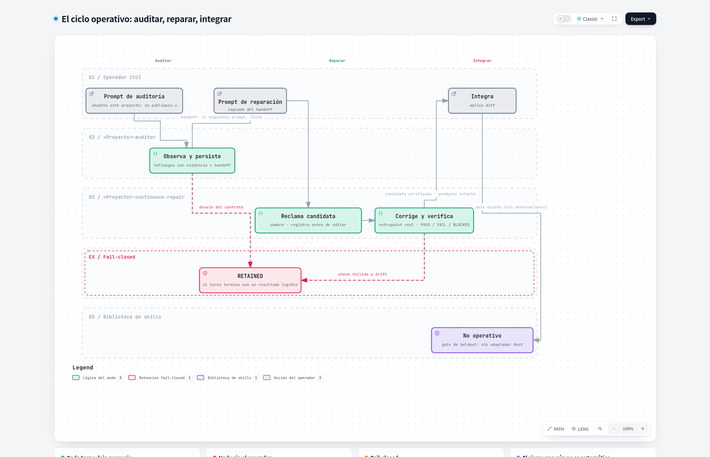
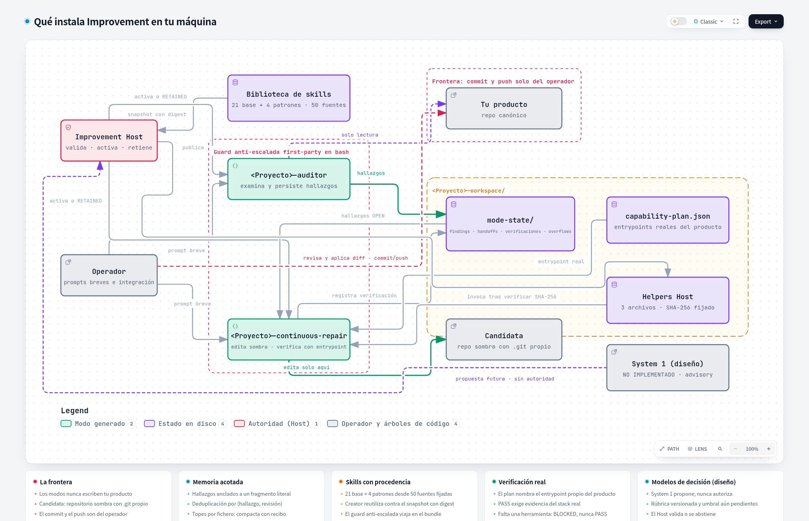

# Improvement

[English](README.md) | **Español**

[](LICENSE) [](docs/plans/10-lanzamiento-publico.es.md) [](https://github.com/MadManJohnSmith/Improvement/actions/workflows/ci.yml) [](https://github.com/MadManJohnSmith/Improvement/releases)

**Un auditor y un reparador que viven junto a tu repositorio: encuentran los defectos
reales, los arreglan verificados contra tus propios tests, y dejan el commit y el push en
tus manos.**

Si mantienes un proyecto vivo, esto te suena: la misma clase de bug vuelve cada pocas
semanas, la auditoría a fondo siempre queda para mañana, y el porqué de cada arreglo
vive en la cabeza de quien lo hizo. Improvement convierte esa rutina en un ciclo con
memoria: le hablas en prompts de una línea, el framework hace el trabajo pesado, y tú
decides qué se integra.

Todo lo que dice este README se midió, no se prometió: el framework ha corrido tres
campañas completas sobre repositorios reales — Syncify (una app de música en
Rust/Tauri/Vue), RehabWeb (una app clínica en Django/Vue) y LoboApp (una app Flutter
instalada desde un clon de GitHub) — y una cuarta sobre sí mismo.

## El problema que resuelve

- **Los bugs vuelven.** Nadie recuerda el arreglo anterior, así que nadie lo comprueba.
- **Las auditorías nunca llegan.** Son grandes, interrumpen, y es fácil posponerlas.
- **El conocimiento se evapora.** El arreglo sale; la evidencia, el test y el motivo no
  sobreviven a la sesión.

Improvement responde a cada uno con algo que persiste en disco: hallazgos con evidencia,
una cola de trabajo que sobrevive entre sesiones, y una memoria que reconoce cuando ese
defecto exacto se cerró antes — y qué lo arregló.

## Lo que tu proyecto obtiene

Al instalar, Improvement genera **tres presets de agente a medida de tu repositorio** y
los instala en DSH, donde les hablas:

| Agente | Qué hace |
|---|---|
| `<TuProyecto>-auditor` | Examina tu código y registra cada hallazgo con su evidencia (`archivo:línea`), severidad, causa y prevención. |
| `<TuProyecto>-continuous-repair` | Toma los hallazgos, los arregla en un repositorio sombra aislado, y verifica cada arreglo contra los tests reales de tu proyecto. |
| `<TuProyecto>-implementer` *(opcional)* | Atiende un encargo de cambio aparte en su propia candidata sombra. |

Las generaciones de dos roles (auditor + reparador) siguen siendo válidas; el
implementador es opcional.

Una regla gobierna todo: **los agentes nunca hacen commit, nunca publican, y nunca tocan
el árbol de tu producto.** Dejan una candidata verificada y la evidencia registrada — la
decisión, el commit y el push son tuyos. Esa frontera está probada con tests, no
prometida.

## Lo que los agentes saben hacer

Los agentes se componen desde una biblioteca de **23 skills inmutables** — cada una es
un procedimiento con invariantes y límites, no un párrafo de consejos — compilada en un
corpus ejecutable de **59 casos** que gatea cada cambio de aprendizaje — cubre el ciclo
completo de ingeniería:

- **Calidad de software:** desarrollo guiado por tests, verificación antes de declarar
  algo completo, pedir y recibir revisión de código, reducción de complejidad protegida
  por tests, implementación incremental.
- **Investigación:** depuración sistemática (primero una reproducción mínima — un fallo
  que no se puede reproducir no se corrige a ciegas), razonamiento anclado en fuentes,
  donde cada afirmación operativa lleva fuente y estado: OBSERVED, INFERRED o ASSUMED,
  curación de contexto, y una retrospectiva que convierte los fallos de una sesión en
  cambios permanentes del entorno.
- **Seguridad:** mínimos de hardening (secretos, fronteras, privilegio mínimo,
  dependencias revisadas), más patrones de auditoría especializados que se activan solo
  con señales de tu repo: revisión estática de políticas IAM de AWS marcando wildcards
  sin justificación, cabeceras HTTP de seguridad (CSP, CORS, cookies, HSTS) distinguiendo
  lo declarado de lo efectivo, comprobación de contratos OpenAPI de FastAPI clasificando
  cada diferencia como compatible, breaking o ambigua, y accesibilidad WCAG 2.2 con
  evidencia por criterio.
- **Planificación y entrega:** planes de unidades verificables con presupuesto por
  unidad y reanudación idempotente, especificaciones con invariantes y anti-goals,
  deprecaciones con ventana de migración declarada, preparación de lanzamiento con
  rollback declarado y rollout por etapas.

De la calidad del software a la ciberseguridad, la investigación y la entrega: lo que tu
auditoría o tu reparación necesite ya está en la biblioteca, y cada reutilización se
declara y se verifica contra la instantánea congelada.

## Lo que Creator construye para ti

Los agentes no se escriben a mano — se **generan para tu repositorio** con Creator, un
agente generador dedicado que trabaja en una sesión confinada: tu producto y el
framework están montados en solo lectura para él, escribe solo dentro de su directorio
de corrida, y nunca ve tus claves de API. Leyendo tu repo compone los presets, sus
skills, contratos, plantillas y un plan de aceptación — un paquete completo y auditable
guardado en `creator-runs/` con su propio id de generación. Todo el pipeline es una línea
de comandos determinista (`bootstrap.py`: install, accept, finalize, repair, update,
uninstall, state, metrics, workflow), y cada paso deja archivos que puedes inspeccionar.

- **Mínimo privilegio por construcción.** Cada agente generado lleva un contrato de
  capacidades: lo que puede hacer — `product_read`, `candidate_write`, `test_execute`,
  `report` — y lo que nunca puede hacer. La generación de RehabWeb, por ejemplo,
  prohíbe `network` y `credential_access` de plano, y ningún paquete de modos puede
  pedir delegación, subagentes ni escalación. El validador además rechaza cualquier
  ruta absoluta (nada que solo funcione en tu máquina) y cualquier llamada de red dentro
  de los artefactos generados.
- **Validado antes de tocar tu máquina.** El Host corre 10 capas deterministas sobre el
  paquete — esquema, manifiesto, grafo de dependencias, contratos por skill,
  capacidades, portabilidad, presupuesto de contexto, colisiones de nombres, licencias y
  ciclo de vida de los modos — y la aceptación ensaya luego las partes duras de verdad:
  una reparación rojo→verde sobre una candidata, una re-auditoría semántica y un ensayo
  de rollback. Solo entonces la transacción mueve la generación por `GENERATED →
  VALIDATING → BACKED_UP → STAGED → ACCEPTING → ACTIVE`.
- **El fallo es un estado, no un desastre.** Si cualquier gate falla, la corrida termina
  `RETAINED` o `ROLLED_BACK` con un motivo legible y un estado recuperable; los
  checkpoints hacen cada fase reanudable, y una corrida retenida puede finalizarse
  después en vez de empezar de cero. Nada se instala a medias: es backup, stage, accept,
  activate — o rollback.
- **Determinista donde importa.** El Host recalcula la mitad derivada del manifiesto —
  artefactos, hashes, procedencia, digest de routing — y escribe él mismo las partes
  mecánicas de cada modo; solo las decisiones específicas del proyecto salen del modelo.
  El presupuesto por defecto de generación es 500.000 tokens facturables / 30 minutos /
  3 intentos, y una vía totalmente determinista (`--host-package`) puede construir el
  paquete sin gastar uno solo. Y Creator no puede aprobarse a sí mismo: solo puede
  declarar el paquete `GENERATED` — el veredicto es del Host.

## Cómo funciona: el ciclo



*Ciclo operativo conceptual. Versión explorable, cada relación se puede rastrear:
[diagrama interactivo](https://madmanjohnsmith.github.io/Improvement/diagrams/ciclo-operativo.es.html) (controles de la interfaz compartida en inglés).*

### 1 · Escribes una línea

«Audita este flujo, característica o componente.» El auditor examina tu proyecto y
persiste lo que encuentra — no como texto de chat que se pierde al hacer scroll, sino
como registros en disco cuya evidencia es un fragmento literal de código. Un fragmento
que no se puede localizar en tu código **rechaza la escritura** en vez de adivinar una
línea.

### 2 · El reparador trabaja en una sombra

«Repara A-SEC-01 y A-SEC-02; no publiques.» El reparador reclama un **repositorio
sombra** aislado — una copia completa con su propio `.git`, aprovisionado por el Host —
y edita ahí. El árbol de tu producto queda intacto mientras trabaja.

### 3 · La verificación es real, nunca con stubs

El arreglo se verifica con **los comandos de tu propio proyecto** — los que un plan de
capacidades firmado leyó de tu repositorio al instalar, monorepos incluidos. Un comando
inventado, un mock, o una copia del código del producto son material de investigación,
nunca un resultado. Si falta una herramienta, el registro es `BLOCKED` nombrando
exactamente qué instalar — nunca un `PASS` inventado.

### 4 · Tú integras

Cada auditoría deja un handoff con el siguiente prompt listo para copiar; cada arreglo
deja el diff y la verificación registrada a su lado. Tú revisas, tú haces commit, tú
publicas. [Procedimiento del operador](docs/usage.es.md#integración-y-recuperación-de-espacio-operador).

## Inicio

### Requisitos

Linux, `git` y Python 3, más [DSH](docs/setup-dsh.es.md) ya configurado con al menos un
provider/modelo propio. Nada más.

**¿Qué es DSH?** Improvement no trae su propia IA: funciona sobre **DSH (DeepSeek
Harness)**, el runtime de agentes open source de DeepSeek (licencia MIT, más de 240.000
estrellas en GitHub). Su arquitectura es *everything is a plugin*; corre en tu máquina y
abre una web app local en el navegador (`npx @deepseek-ai/dsh web`); su
[documentación](https://deepseek-harness.github.io/deepseek-harness/) cuenta el resto. Los
agentes generados viven ahí como presets, y tus credenciales de provider viven ahí
también — Improvement nunca las lee ni las pide.

### Instalación

Clona el framework **junto a tu proyecto, nunca dentro de él**, y corre un comando:

```bash
git clone https://github.com/MadManJohnSmith/Improvement.git
cd Improvement
python3 -B scripts/bootstrap.py install \
  --project /ruta/a/tu/proyecto \
  --launch-dsh
```

Eso descubre tu proyecto y pide la generación de los presets y sus skills; cuando
Creator completa el paquete, el Host lo valida en 10 capas, hace copia de seguridad,
instala y activa. Si algo falla, revierte dejando un estado recuperable. Tu producto no
se toca durante la instalación. Antes del primer encargo, los agentes incorporan tu
proyecto desde un perfil explícito — objetivo, comandos permitidos, datos excluidos,
presupuesto — en vez de improvisar.

Y si lo pruebas: topar con algo raro es exactamente para lo que existe la beta. [Abre un
issue](https://github.com/MadManJohnSmith/Improvement/issues) con tus archivos de
`mode-state` (`findings.jsonl`, `handoffs.jsonl`, `verification-results.jsonl`, sin el
código de tu producto) y los turnos que quedaron retenidos y por qué. Ese es el reporte
más útil posible, y es exactamente el formato que el framework ya produce.

## Uso diario

Con los presets activos en DSH, operas con mensajes cortos:

| Quieres… | Escribes |
|---|---|
| Auditar todo | «Audita completamente este proyecto; no modifiques ni publiques.» |
| Auditar una zona | «Audita este flujo, característica o componente.» |
| Reparar lo auditado | «Repara los hallazgos de la auditoría; no publiques.» |
| Reparar hallazgos concretos | «Repara A-SEC-01 y A-SEC-02; no publiques.» |

## Lo que deja en tu máquina



*La biblioteca que alimenta la generación, los agentes, la memoria acotada y la frontera
de integración. Las piezas diseñadas pero aún no implementadas están marcadas como tal.
Explorable: [versión interactiva](https://madmanjohnsmith.github.io/Improvement/diagrams/arquitectura-instalacion.es.html) (controles de la interfaz compartida en inglés).*

```text
tu-proyecto/
tu-proyecto-workspace/
├── mode-state/
│   ├── findings.jsonl            # hallazgos con evidencia y estado
│   ├── handoffs.jsonl            # un registro por auditoría, con el siguiente prompt
│   ├── verification-results.jsonl  # cómo se verificó cada arreglo
│   ├── overflows.jsonl           # lo que la compactación descartó, y por qué
│   └── work-items.json           # cola de trabajo y candidata activa
├── .dsh-managed/
│   └── capability-plan.json      # los comandos reales de tu proyecto y lo que falta
└── creator-runs/                 # lo que Creator generó, con sus validaciones
```

Todo son archivos planos que puedes leer. La memoria tiene topes estrictos por archivo y
por registro: compacta al alcanzarlos, y lo que la compactación descarta deja un recibo
en `overflows.jsonl` — nada desaparece en silencio. La memoria también se consulta a sí
misma: cuando un hallazgo coincide con uno cerrado antes, el registro lleva
`prior_episode` con la unidad que lo cerró y el arreglo que funcionó, y `bootstrap.py
state` cuenta las repeticiones, porque una prevención que falló es un defecto distinto
del primero.

El vocabulario que verás:

| Término | Qué es |
|---|---|
| Modo | El nombre interno de cada agente: un preset específico de tu proyecto — auditor, continuous-repair o implementer. |
| Hallazgo | Un defecto registrado con evidencia (`archivo:línea`), severidad, causa y prevención. |
| Handoff | El registro que deja cada auditoría, con el siguiente prompt listo para copiar. |
| Candidata | El repositorio sombra aislado donde el reparador cambia código. |
| `mode-state` | La memoria en disco del workspace: hallazgos, handoffs, verificaciones, recibos. |
| Plan de capacidades | El inventario de los comandos reales de test y análisis de tu proyecto, firmado al instalar. |
| RETAINED | Un turno que terminó con un resultado legible sin salirse de su contrato. |
| VERIFIED / RESOLVED | Trabajo verificado contra comandos reales; defectos cerrados con evidencia. |
| Biblioteca de skills | Las 23 skills base inmutables de las que se componen los modos, con fuentes registradas. |

## Tu proyecto no es el banco de pruebas

Improvement está construido para que un mal día de los agentes no sea un mal día de tu
repositorio:

- **El reparador edita un repositorio sombra** con su propio `.git` — no una rama, no un
  worktree de tu producto. No hay ascendencia compartida que mezclar mal, y el árbol de
  tu producto permanece limpio.
- **El auditor puede quedar bloqueado a nivel kernel.** Con la política apuntando al
  workspace, bash recibe un `EROFS` real al intentar escribir tu producto — y el auditor
  aún persiste sus hallazgos.
- **La escalación está prohibida por estructura.** Los agentes nunca envían argumentos
  de escalación de permisos, con ningún valor; una guardia de primera parte los bloquea
  en bash antes de la aprobación, con regresión contra el runtime real.
- **La instalación hace backup y revierte.** Si algo falla, queda un estado recuperable;
  tu producto no se toca durante la instalación.
- **El workspace es un directorio hermano**, nunca dentro de tu repo — y sin autoridad,
  el turno se abstiene. Medido, no prometido.
- **Una sesión muerta no es trabajo perdido.** Una candidata interrumpida se reanuda
  verificando la identidad exacta registrada (misma sombra, misma base, mismo digest de
  hallazgos), y `bootstrap.py state` reconcilia el workspace con tu repositorio, con
  recibos en vez de silencios.

## Más allá de auditar y reparar

- **Campañas completas con un comando.** El Host lleva un ejecutor de planes (`bootstrap
  workflow run`): la campaña por defecto recorre preflight, auditoría, verificación
  pre-reparación, reparación, verificación post-reparación, una segunda reparación si
  hace falta, verificación final y cierre — cada paso con su checkpoint, reanudable si
  una sesión muere. Ejercitado de extremo a extremo en una sesión DSH real sobre un
  producto ficticio (una reparación en rojo volvió PASS tras reparar); una campaña sobre
  un producto vivo es parte de para lo que existe la beta.
- **Documentación que no puede pudrirse en silencio.** `bootstrap drift` evalúa cuánto
  se han desviado tus docs del código — de forma determinista, sin red y sin modelo: un
  hash de contrato sobre cada firma pública de función, una huella sobre los cuerpos de
  las funciones, y una clasificación de deriva (deriva de contrato, referencia obsoleta,
  deriva de fuente) al cierre del turno. Cuando encuentra deriva, presenta una propuesta
  de sincronización — sync propone; solo una instalación autorizada reemplaza.
- **Evaluación honesta.** El harness de evaluación puntúa corridas offline, de forma
  determinista y sin modelo: un criterio pre-registrado comprueba el journal de la
  corrida contra evidencia externa, y nada puede auto-aprobarse — solo una corrida de
  verificación pre-registrada puede entrar en el corpus versionado.

## Historias reales

### Syncify: de CI en rojo a CI en verde

Una app de música (Rust/Tauri/Vue) con la suite en rojo. A lo largo de la campaña los
agentes encontraron y arreglaron defectos reales, no solo de tests: un validador de WebP
que rechazaba archivos legales, un conteo de álbumes que leía un disco de 10 pistas como
uno de 1, un deadlock de SQLite que colgaba la CI al 0% de CPU, un puente de descargas
que firmaba peticiones con un secreto vacío.

| Métrica | Resultado |
|---|---|
| Hallazgos distintos persistidos | 77 (114 registros con su historia) |
| Trabajo verificado | 78 elementos VERIFIED |
| Verificaciones persistidas | 67 (61 PASS, 6 declaradas BLOCKED) |
| Commits generados e integrados | 15 |
| Resultado | CI verde en los 3 jobs (Rust, frontend, Python) |

### RehabWeb: 45 hallazgos de seguridad, un prompt de seis palabras

Una app clínica (Django/Vue), instalada limpia con un solo comando. La primera auditoría
encontró **45 hallazgos (6 CRITICAL, 16 HIGH, 23 MEDIUM)** — entre ellos: cualquier
usuario autenticado podía leer la historia clínica de toda la población, y un paciente
podía reescribir el diagnóstico de otro. El prompt «Repara A-SEC-01 y A-SEC-02; no
publiques.» produjo el arreglo de ambos, con su test de regresión (3 archivos, 220
líneas), sin tocar el árbol del producto hasta la integración.

### LoboApp: la campaña que encontró los límites

Una app Flutter instalada **desde un clon de GitHub del framework** sobre un producto
recién clonado y sin contaminación previa — exactamente el escenario al que llega quien
la prueba. La auditoría persistió 9 hallazgos (1 CRITICAL: el aviso de privacidad
prometía que cerrar sesión borra lo guardado, y el código no lo hacía). «Repara F-01 y
F-02; no publiques.» produjo el arreglo con sus tests de regresión, verificado con un
`flutter test` real (125 en verde). La campaña cerró en **14 hallazgos resueltos, 166
tests Flutter en verde, 4 commits integrados** — y destapó dos fallos del framework que
ningún test sintético habría visto: un comando de verificación que su propio shell no
podía ejecutar, y un sandbox que dejaba el SDK montado en solo lectura mientras la
herramienta se reescribe a sí misma. Ambos están arreglados con tests de regresión, y
son la razón de que la verificación aquí sea real en vez de declarativa.

### El framework, sobre sí mismo

Instalado sobre un clon de sí mismo, el auditor encontró 7 defectos reales del framework (2 HIGH, 5 MEDIUM) y el reparador los arregló todos con sus tests. La re-auditoría encontró después el más incómodo: **un resultado de verificación no identificaba el árbol que verificó** — ahora cada registro lleva el digest del diff verificado, comprobado en tres sitios. La memoria también se aplica a sí misma: una auditoría de la memoria encontró un registro de defectos ya cerrados que se escribía pero nadie consultaba, así que el mismo defecto podía volver cada sesión; la consulta ahora es mecánica. Suite del framework: **1428 pruebas en verde** (12 saltadas en una máquina sin el runtime DSH externo ni `jsonschema`, medida el 2026-11-17).

### Pilotado por una sesión DSH real (2026-10-10)

Las campañas de arriba corrieron sobre repositorios reales; este pase fue más acotado —
un producto ficticio con un defecto conocido, pilotado por una **sesión DSH real**: la
auditoría persistió su hallazgo con evidencia, un prompt de seis palabras dejó el commit
`ab5c0c6` con tests en verde y el producto intacto, el implementador dejó la candidata
`95aa9b2` con 6 tests nuevos, las skills se cargaron por rol, el turno abstuvo cuando
faltaba autoridad, y el validador del Host pasó 10 de 10 capas sobre el paquete real. Lo
que ese pase **no** probó — Creator de extremo a extremo bajo techos de tokens, el corpus
gate puntuando un modo real — está medido y contado con sus cifras en el
[estado comprobado](docs/status.es.md).

### Creator de extremo a extremo en el fixture (2026-11-13)

Esa puerta abierta se cerró por el diseño del propio flujo: una sesión real de Creator
(prompt 1.12.0) produjo el paquete completo sobre el workspace fixture versionado, el
Host lo retuvo por hallazgos de portability, un turno de reparación los limpió, y la
activación transaccional dejó `gen-e9b8a23da747` **ACTIVE** — tres presets publicados,
mode-state provisionado, verificado con `verify-acceptance`. La aceptación del Host aquí
es estática más materialización (`dynamic_evaluation: NOT_RUN`): la aceptación por un
operador de producción sobre un producto real, y la aceptación completa de escritorio,
no se afirma por él.

## Lo que NO hace — y lo que falta

**A propósito:**

- **No hace commit ni push.** La integración es la frontera de seguridad, y está probada.
- **No es autónomo en las sombras.** Cada turno termina con un resultado legible; lo que
  queda retenido se dice, y por qué.
- **No instala providers ni credenciales.** DSH y tu provider son prerequisitos.
- **El confinamiento del reparador es contractual, no mecánico.** El bloqueo a nivel
  kernel cubre hoy al auditor; el reparador necesita dos raíces escribibles y el runtime
  solo acepta una — así que su frontera es el contrato, probado.

**Falta para la versión estable** — cada elemento con su fecha y evidencia en el
[estado comprobado](docs/status.es.md), la secuencia completa en el [plan de
lanzamiento](docs/plans/10-lanzamiento-publico.es.md): Creator cerrando de extremo a
extremo bajo techos de tokens reales, el corpus gate puntuando un modo real, y una
corrida completa de Creator con la sombra aprovisionada por el Host.

**Hacia dónde va** — ya diseñado y versionado en el repo:

- Un instalador que trae su propio DSH: sin terminal, sin archivos de configuración,
  acceso guiado al provider, una instantánea de tu proyecto si aún no tiene git, y **una
  sola aprobación para todo el paquete** — con la primera auditoría corrida por el
  framework y cada fallo explicado en lenguaje llano ([la experiencia de instalación
  diseñada](workflows/product-install.md)).
- **Tus bucles recurrentes como specs aprobados**: describes un bucle una vez («cuando
  falla un test, audita, repara y verifica»), obtienes un spec versionado con disparador,
  pasos y criterio de éxito; cualquier cambio exige re-aprobación, y lo que te deja es
  la decisión lista para tomar, no salida cruda ([la experiencia de workflows
  diseñada](workflows/user-workflow-design.md)).
- Un **canal asesor System 1**: un modelo rápido propone, el modo de razonamiento
  endosa o veta — diseñado, con su prerrequisito verificado; aún sin implementar.
- El **bucle de aprendizaje de la biblioteca**: las observaciones de campaña alimentando
  de vuelta la biblioteca de skills por el gate de holdout — el gate está implementado;
  falta la primera corrida operativa contra un modo real.

## Para perfiles técnicos

**De dónde salen los agentes.** No se estampan desde una plantilla vacía: la generación
los compone desde una biblioteca de skills con procedencia registrada — **23 skills base
inmutables** (desarrollo guiado por tests, depuración sistemática, hardening de
seguridad, revisión de código, escritura de planes…) reimplementadas con atribución MIT,
más **4 patrones de catálogo** que se activan solo cuando su señal aparece de verdad en
tu repo (revisión estática de políticas AWS IAM, verificación de cabeceras HTTP de
seguridad, comprobación de contratos OpenAPI de FastAPI, accesibilidad WCAG 2.2),
respaldados por **79 fuentes externas fijadas** (de 104 registradas) — repositorios de
skills, estándares y guías de plataforma — con URL, revisión y licencia registradas para
cada una. La selección sigue un orden obligatorio: primero una skill base; luego un
patrón de catálogo, solo si la señal está realmente ahí; luego composiciones; y una
extensión nueva solo como último recurso, obligada a demostrar que las capas anteriores
no aplican. Cada reutilización se declara, y el Host la verifica contra la instantánea de
la biblioteca congelada con su digest al instalar: lo que tu agente reutiliza es
exactamente lo que el digest firmó.

**Una verificación que no puede mentir por accidente.** El plan de capacidades está
firmado, y el reparador no puede registrar un resultado de un comando fuera de él. Un
hallazgo ancla su ubicación con un fragmento literal de código (`path` + `excerpt`): la
herramienta de escritura localiza el fragmento, calcula la línea, y rechaza la escritura
si el fragmento no está o aparece más de una vez — un ancla que no se puede colocar es un
ancla apuntando a la línea equivocada. `bootstrap.py state` informa de cuántos hallazgos
están anclados. El conteo persistido lo recalcula un comando central que exige que el
handoff cubra los hallazgos exactamente; un resultado parcial o contradictorio nunca se
escribe.

**Lo que está blindado.** Los modos nunca envían `sandbox_permissions` ni
`justification` — con ningún valor — y una guardia de primera parte intercepta esos
argumentos en bash antes de la aprobación; una regresión contra el runtime real monta la
composición exacta y bloquea `workspace-write` y `danger-full-access` de plano. El
auditor se puede confinar en el kernel: con la política apuntando al workspace, bash
recibe un `EROFS` real cuando intenta escribir tu producto, y el auditor aún puede
persistir sus hallazgos. Medido contra el runtime, con regresiones.

**Stacks.** Probados en campañas reales: Rust (`cargo test`, `cargo clippy`), Django
(`python manage.py test`, `django check`), Flutter (`flutter test`, `flutter analyze`) y
Python (`pytest -q`, `compileall` — el framework sobre sí mismo). Veintiséis más están
declarados: el plan resuelve sus comandos igual, y una herramienta ausente da `BLOCKED`
nombrándola — nunca un `PASS` inventado. Ejercitarlos sobre repositorios reales es
exactamente para lo que existe la beta. La tabla completa, una fila por stack, está en el
[estado comprobado](docs/status.es.md).

## Documentación

- [Uso operativo](docs/usage.es.md) — el ciclo completo, integración y recuperación de espacio
- [Diagramas interactivos](https://madmanjohnsmith.github.io/Improvement/diagrams/ciclo-operativo.es.html) — el ciclo operativo y la [arquitectura instalada](https://madmanjohnsmith.github.io/Improvement/diagrams/arquitectura-instalacion.es.html), como HTML explorables
- [Configuración de DSH](docs/setup-dsh.es.md)
- [Estado comprobado](docs/status.es.md) — qué está probado y qué no, siempre como historia con su fecha
- [Progreso de hitos, una página](docs/progreso-agentico.es.md) — cada hito C/D/E/F/G/M/P/U con su estado derivado y su evidencia
- [Arquitectura normativa](ARQUITECTURA_FLUJO_AGENTES.es.md)
- [Experiencia de instalación diseñada](workflows/product-install.md) · [Workflows de usuario diseñados](workflows/user-workflow-design.md) — las siguientes experiencias, como specs versionados
- [Skills de agentes y reglas del repositorio](AGENTS.md) — para mantenedores
- [Planes de implementación](docs/plans/README.es.md) · [Plan de lanzamiento](docs/plans/10-lanzamiento-publico.es.md)
- [Cambios](CHANGELOG.md) · [Atribuciones de terceros](THIRD_PARTY_NOTICES.es.md)
- [Notas de la beta v0.1.0](docs/plans/11-notas-beta-v0.1.0.es.md) (publicadas 2026-09-30)

## Licencia

Apache-2.0 ([LICENSE](LICENSE)). Las skills de terceros y sus atribuciones están en
[THIRD_PARTY_NOTICES.es.md](THIRD_PARTY_NOTICES.es.md).
