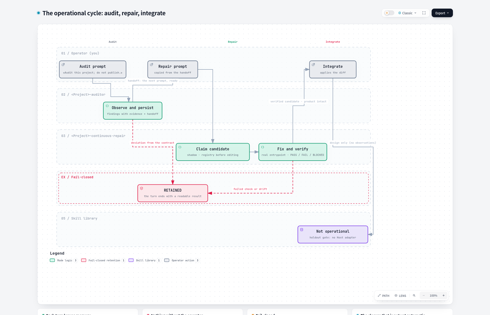
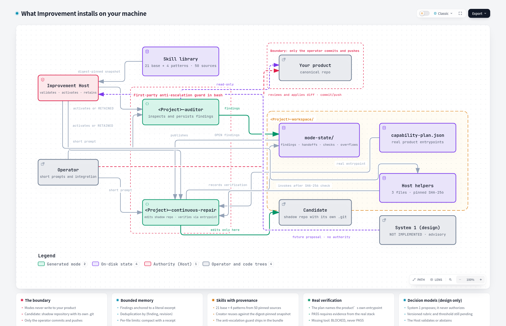

# Improvement

**English** | [Español](README.es.md)

[](LICENSE) [](docs/plans/10-lanzamiento-publico.md) [](https://github.com/MadManJohnSmith/Improvement/actions/workflows/ci.yml) [](https://github.com/MadManJohnSmith/Improvement/releases)

**An auditor and a repairer that live next to your repository: they find the real
defects, fix them verified against your own tests, and leave the commit and the push in
your hands.**

If you maintain a live project, this sounds familiar: the same class of bug comes back
every few weeks, a deep audit is always left for tomorrow, and the why behind each fix
lives in the head of whoever made it. Improvement turns that routine into a cycle with
memory: you talk to it in one-line prompts, the framework does the heavy lifting, and you
decide what gets integrated.

Everything in this README was measured, not promised: the framework has run three full
campaigns on real repositories — Syncify (a music app in Rust/Tauri/Vue), RehabWeb (a
clinical app in Django/Vue) and LoboApp (a Flutter app installed from a GitHub clone) —
and a fourth on itself.

## The problem it solves

- **Bugs come back.** Nobody remembers the previous fix, so nobody checks for it.
- **Audits never happen.** They are big, interruptive, and easy to postpone.
- **Knowledge evaporates.** The fix ships; the evidence, the test, and the reason do not
  survive the session.

Improvement answers each with something that persists on disk: findings with evidence, a
work queue that survives between sessions, and a memory that recognizes when that exact
defect was closed before — and what fixed it.

## What your project gets

On install, Improvement generates **three agent presets tailored to your repository** and
installs them into DSH, where you talk to them:

| Agent | What it does |
|---|---|
| `<YourProject>-auditor` | Examines your code and records every finding with its evidence (`file:line`), severity, cause, and prevention. |
| `<YourProject>-continuous-repair` | Takes the findings, fixes them in an isolated shadow repository, and verifies each fix against your project's real tests. |
| `<YourProject>-implementer` *(optional)* | Handles a separate change request in its own shadow candidate. |

Two-role generations (auditor + repairer) remain valid; the implementer is opt-in.

One rule governs everything: **the agents never commit, never push, and never touch your
product's tree.** They leave a verified candidate and the recorded evidence — the
decision, the commit, and the push are yours. That boundary is tested, not promised.

## What the agents know how to do

The agents are composed from a library of **23 immutable skills** — each one a procedure
with invariants and limits, not a paragraph of advice — compiled into an executable
corpus of **59 cases** that gates every learning change — covering the whole engineering
loop:

- **Software quality:** test-driven development, verification before declaring something
  done, requesting and receiving code review, complexity reduction protected by tests,
  incremental implementation.
- **Investigation:** systematic debugging (a minimal reproduction first — a failure that
  cannot be reproduced is not fixed blind), source-driven reasoning, where every
  operational claim carries a source and a state: OBSERVED, INFERRED, or ASSUMED,
  context curation, and a retrospective that turns a session's failures into permanent
  environment changes.
- **Security:** hardening minimums (secrets, boundaries, least privilege, reviewed
  dependencies), plus specialized audit patterns that activate only on signals in your
  repo: static review of AWS IAM policies with unjustified wildcards flagged, HTTP
  security headers (CSP, CORS, cookies, HSTS) distinguishing what is declared from what
  is effective, FastAPI OpenAPI contract checks classifying each difference as
  compatible, breaking, or ambiguous, and WCAG 2.2 accessibility with evidence per
  criterion.
- **Planning and delivery:** plans made of verifiable units with a per-unit budget and
  idempotent resumption, specs with invariants and anti-goals, deprecations with a
  declared migration window, launch preparation with a declared rollback and staged
  rollout.

From software quality to cybersecurity, investigation, and shipping: what your audit or
your repair needs is already in the library, and every reuse is declared and verified
against the frozen snapshot.

## What Creator builds for you

The agents are not written by hand — they are **generated for your repository** by
Creator, a dedicated generator agent working in a confined session: your product and the
framework are mounted read-only for it, it writes only inside its run directory, and it
never sees your API keys. From reading your repo it composes the presets, their skills,
contracts, templates, and an acceptance plan — a complete, auditable package kept in
`creator-runs/` with its own generation id. The whole pipeline is a deterministic command
line (`bootstrap.py`: install, accept, finalize, repair, update, uninstall, state,
metrics, workflow), and every step leaves files you can inspect.

- **Least privilege by construction.** Every generated agent ships with a capability
  contract: what it may do — `product_read`, `candidate_write`, `test_execute`,
  `report` — and what it can never do. The RehabWeb generation, for instance, forbids
  `network` and `credential_access` outright, and no mode package may request
  delegation, subagents, or escalation. The validator also rejects any absolute path
  (nothing that only works on your machine) and any network call inside the generated
  artifacts.
- **Validated before anything touches your machine.** The Host runs 10 deterministic
  layers over the package — schema, manifest, dependency graph, per-skill contracts,
  capabilities, portability, context budget, name collisions, licenses, and mode
  lifecycle — and acceptance then rehearses the hard parts for real: a red→green repair
  on a candidate, a semantic re-audit, and a rollback drill. Only then does the
  transaction move the generation through `GENERATED → VALIDATING → BACKED_UP → STAGED
  → ACCEPTING → ACTIVE`.
- **Failure is a state, not a mess.** If any gate fails, the run ends `RETAINED` or
  `ROLLED_BACK` with a readable reason and a recoverable state; checkpoints make every
  phase resumable, and a retained run can be finalized later instead of starting over.
  Nothing installs halfway: it is backup, stage, accept, activate — or roll back.
- **Deterministic where it matters.** The Host recomputes the derived half of the
  manifest — artifacts, hashes, provenance, routing digest — and writes the mechanical
  parts of every mode itself; only the project-specific decisions come from the model.
  The default generation budget is 500,000 billable tokens / 30 minutes / 3 attempts,
  and a fully deterministic path (`--host-package`) can build the package without
  spending a single one. And the Creator cannot approve itself: it can only declare the
  package `GENERATED` — the verdict belongs to the Host.

## How it works: the cycle



*Conceptual operating cycle. Explorable version, every relationship traceable:
[interactive diagram](https://madmanjohnsmith.github.io/Improvement/diagrams/ciclo-operativo.html).*

### 1 · You write one line

«Audita este flujo, característica o componente.» The auditor examines your project and
persists what it finds — not as chat text that scrolls away, but as records on disk whose
evidence is a literal code snippet. A snippet that cannot be located in your code
**rejects the write** instead of guessing a line number.

### 2 · The repairer works in a shadow

«Repara A-SEC-01 y A-SEC-02; no publiques.» The repairer claims an isolated **shadow
repository** — a full copy with its own `.git`, provisioned by the Host — and edits
there. Your product's tree is untouched while it works.

### 3 · Verification is real, never stubs

The fix is verified with **your project's own commands** — the ones a signed capability
plan read from your repository at install time, monorepos included. An invented command,
a mock, or a copy of the product's code is investigation material, never a result. If a
tool is missing, the record is `BLOCKED` naming exactly what to install — never an
invented `PASS`.

### 4 · You integrate

Every audit leaves a handoff with the next prompt ready to copy; every repair leaves the
diff and the recorded verification next to it. You review, you commit, you push.
[Operator procedure](docs/usage.md#integration-and-space-recovery-operator).

## Getting started

### Requirements

Linux, `git`, and Python 3, plus [DSH](docs/setup-dsh.md) already configured with at
least one provider/model of your own. Nothing else.

**What is DSH?** Improvement does not bring its own AI: it works on top of **DSH (DeepSeek
Harness)**, DeepSeek's open source agent runtime (MIT license, more than 240,000 stars on
GitHub). Its architecture is *everything is a plugin*; it runs on your machine and opens a
local web app in the browser (`npx @deepseek-ai/dsh web`); its
[documentation](https://deepseek-harness.github.io/deepseek-harness/) tells the rest. The
generated agents live there as presets, and your provider credentials live there too —
Improvement never reads them or asks for them.

### Install

Clone the framework **next to your project, never inside it**, and run one command:

```bash
git clone https://github.com/MadManJohnSmith/Improvement.git
cd Improvement
python3 -B scripts/bootstrap.py install \
  --project /path/to/your/project \
  --launch-dsh
```

That discovers your project and requests the generation of the presets and their skills;
when Creator completes the package, the Host validates it in 10 layers, backs up,
installs, and activates. If anything fails, it rolls back leaving a recoverable state.
Your product is not touched during installation. Before the first change request, the
agents onboard your project from an explicit profile — objective, allowed commands,
excluded data, budget — instead of improvising.

And if you try it: hitting something odd is exactly what the beta is for. [Open an
issue](https://github.com/MadManJohnSmith/Improvement/issues) with your `mode-state`
files (`findings.jsonl`, `handoffs.jsonl`, `verification-results.jsonl`, without your
product's code) and the turns that ended retained and why. That is the most useful report
possible, and it is the format the framework already produces.

## Everyday use

With the presets active in DSH, you operate with short messages:

| You want… | You write |
|---|---|
| Audit everything | «Audita completamente este proyecto; no modifiques ni publiques.» |
| Audit one area | «Audita este flujo, característica o componente.» |
| Repair what was audited | «Repara los hallazgos de la auditoría; no publiques.» |
| Repair specific findings | «Repara A-SEC-01 y A-SEC-02; no publiques.» |

## What it leaves on your machine



*The library that feeds generation, the agents, the bounded memory, and the integration
boundary. Pieces designed but not yet implemented are marked as such. Explorable:
[interactive version](https://madmanjohnsmith.github.io/Improvement/diagrams/arquitectura-instalacion.html).*

```text
your-project/
your-project-workspace/
├── mode-state/
│   ├── findings.jsonl            # findings with evidence and state
│   ├── handoffs.jsonl            # one record per audit, with the next prompt
│   ├── verification-results.jsonl  # how each fix was verified
│   ├── overflows.jsonl           # what compaction discarded, and why
│   └── work-items.json           # work queue and active candidate
├── .dsh-managed/
│   └── capability-plan.json      # your project's real commands and what is missing
└── creator-runs/                 # what Creator generated, with its validations
```

All of it is plain files you can read. The memory has strict caps per file and per
record: it compacts when it reaches them, and what compaction discards leaves a receipt
in `overflows.jsonl` — nothing disappears silently. The memory also consults itself: when
a finding matches one closed before, the record carries `prior_episode` with the unit
that closed it and the fix that worked, and `bootstrap.py state` counts the repeats,
because a prevention that failed is a different defect from the first one.

The vocabulary you will see:

| Term | What it is |
|---|---|
| Mode | The internal name for one of the agents: a project-specific preset — auditor, continuous-repair, or implementer. |
| Finding | A defect recorded with evidence (`file:line`), severity, cause, and prevention. |
| Handoff | The record every audit leaves behind, with the next prompt ready to copy. |
| Candidate | The isolated shadow repository where the repairer changes code. |
| `mode-state` | The workspace's on-disk memory: findings, handoffs, verifications, receipts. |
| Capability plan | The inventory of your project's real test and analysis commands, signed at install. |
| RETAINED | A turn that ended with a readable result without stepping outside its contract. |
| VERIFIED / RESOLVED | Work verified against real commands; defects closed with evidence. |
| Skills library | The 23 immutable base skills the modes are composed from, with recorded sources. |

## Your project is never the test bench

Improvement is built so that a bad day for the agents is not a bad day for your
repository:

- **The repairer edits a shadow repository** with its own `.git` — not a branch, not a
  worktree of your product. There is no shared ancestry to merge wrong, and your
  product's tree stays clean.
- **The auditor can be locked out at the kernel level.** With the policy pointed at the
  workspace, bash gets a real `EROFS` when it tries to write your product — and the
  auditor still persists its findings.
- **Escalation is structurally forbidden.** The agents never send permission-escalation
  arguments, with any value; a first-party guard blocks them in bash before approval,
  with a regression against the real runtime.
- **Installation backs up and rolls back.** If anything fails, you get a recoverable
  state; your product is not touched during installation.
- **The workspace is a sibling directory**, never inside your repo — and without
  authority, the turn abstains. Measured, not promised.
- **A dead session is not lost work.** An interrupted candidate resumes by verifying the
  exact recorded identity (same shadow, same base, same findings digest), and
  `bootstrap.py state` reconciles the workspace with your repository, with receipts
  instead of silences.

## Beyond audit and repair

- **Whole campaigns in one command.** The Host carries a plan executor (`bootstrap
  workflow run`): the default campaign walks preflight, audit, pre-repair verification,
  repair, post-repair verification, a second repair if needed, final verification, and
  close-out — each step with its checkpoint, resumable when a session dies. Exercised
  end to end in a real DSH session on a fictional product (a failing repair came back
  PASS after repair); a campaign on a live product is part of what the beta is for.
- **Documentation that cannot rot silently.** `bootstrap drift` evaluates how far your
  docs have drifted from the code — deterministically, with no network and no model: a
  contract hash over each public function signature, a fingerprint over function
  bodies, and a drift classification (contract drift, stale reference, source drift) at
  turn close. When it finds drift, it files a sync proposal — sync proposes; only an
  authorized install replaces.
- **Honest evaluation.** The evaluation harness scores runs offline, deterministically,
  and without a model: a pre-registered criterion checks the run journal against
  external evidence, and nothing can self-approve — only a pre-registered verification
  run can end in the versioned corpus.

## Real stories

### Syncify: from red CI to green CI

A music app (Rust/Tauri/Vue) with a failing suite. Over the campaign the agents found and
fixed real defects, not only test ones: a WebP validator that rejected legal files, an
album count that tagged a 10-track disc as a 1-track one, a SQLite deadlock that hung the
CI at 0% CPU, a download bridge that signed requests with an empty secret.

| Metric | Result |
|---|---|
| Distinct findings persisted | 77 (114 records with their history) |
| Verified work | 78 VERIFIED items |
| Verifications persisted | 67 (61 PASS, 6 declared BLOCKED) |
| Commits generated and integrated | 15 |
| Result | CI green in all 3 jobs (Rust, frontend, Python) |

### RehabWeb: 45 security findings, a six-word prompt

A clinical app (Django/Vue), installed clean from a single command. The first audit found
**45 findings (6 CRITICAL, 16 HIGH, 23 MEDIUM)** — among them: any authenticated user
could read the clinical history of the entire population, and one patient could rewrite
another's diagnosis. The prompt «Repara A-SEC-01 y A-SEC-02; no publiques.» produced the
fix for both, with its regression test (3 files, 220 lines), without touching the
product's tree until integration.

### LoboApp: the campaign that found the limits

A Flutter app installed **from a GitHub clone of the framework** onto a freshly cloned
product with no prior contamination — exactly the scenario a tester walks into. The audit
persisted 9 findings (1 CRITICAL: the privacy notice promised that logging out erases
saved data, and the code did not). «Repara F-01 y F-02; no publiques.» produced the fix
with its regression tests, verified with a real `flutter test` (125 green). The campaign
closed at **14 findings resolved, 166 Flutter tests green, 4 commits integrated** — and
it surfaced two framework failures no synthetic test would have caught: a verification
command its own shell could not execute, and a sandbox that left the SDK mounted
read-only while the tool rewrites itself. Both are fixed with regression tests, and they
are the reason verification here is real instead of declarative.

### The framework, on itself

Installed on a clone of itself, the auditor found 7 real framework defects (2 HIGH, 5 MEDIUM) and the repairer fixed all of them with their tests. The re-audit then found the most uncomfortable one: **a verification result did not identify the tree it verified** — now every record carries the digest of the verified diff, checked in three places. The memory applies to itself too: an audit of the memory found a register of already-closed defects that was written but never consulted, so the same defect could return every session; the consultation is now mechanical. Framework suite: **1378 tests green** (1 skipped, measured 2026-11-17).

### Driven by a real DSH session (2026-10-10)

The campaigns above ran on real repositories; this pass was narrower — a fictional
product with one known defect, driven by a **real DSH session**: the audit persisted its
finding with evidence, a six-word prompt left commit `ab5c0c6` with tests green and the
product untouched, the implementer left candidate `95aa9b2` with 6 new tests, skills
loaded per role, the turn abstained when authority was missing, and the Host validator
passed 10 of 10 layers on the real package. What that pass did **not** prove — Creator
end-to-end under token ceilings, the corpus gate scoring a real mode — is measured and
told with its figures in the
[verified status](docs/status.md#comprehensive-pass-on-real-dsh-2026-10-10-what-was-measured-and-what-was-not).

### Creator end-to-end on the fixture (2026-11-13)

That open gate is closed through the flow's own design: a real Creator session
(prompt 1.12.0) produced the complete package on the versioned fixture workspace, the
Host retained it on portability findings, a repair turn cleared them, and the
transactional activation left `gen-e9b8a23da747` **ACTIVE** — three presets published,
mode state provisioned, verified with `verify-acceptance`. The Host acceptance here is
static plus materialization (`dynamic_evaluation: NOT_RUN`): production-operator and
full-desktop acceptance are not claimed by it.

## What it does not do — and what is still ahead

**On purpose:**

- **It does not commit or push.** Integration is the security boundary, and it is tested.
- **It is not autonomous in the shadows.** Every turn ends with a readable result; what
  is retained is said, and why.
- **It does not install providers or credentials.** DSH and your provider are
  prerequisites.
- **The repairer's confinement is contractual, not mechanical.** The kernel lockout
  covers the auditor today; the repairer needs two writable roots and the runtime only
  accepts one — so its boundary is the tested contract.

**Still ahead for the stable release** — each item with its date and evidence in the
[verified status](docs/status.md), the whole sequence in the
[launch plan](docs/plans/10-lanzamiento-publico.md): the Creator closing end-to-end under
real token ceilings, the corpus gate scoring a real mode, and a full Creator run with the
Host-provisioned shadow.

**Where this is going** — already designed and versioned in the repo:

- An installer that brings its own DSH: no terminal, no config files, guided provider
  access, a snapshot of your project if it has no git yet, and **one approval for the
  whole package** — with the first audit run for you and every failure explained in
  plain language ([the designed install experience](workflows/product-install.md)).
- **Your recurring loops as approved specs**: describe a loop once ("when a test fails,
  audit, repair, and verify"), get a versioned spec with trigger, steps, and success
  criteria; any change to it requires re-approval, and what it leaves you is the
  decision ready to make, not raw output
  ([the designed workflow experience](workflows/user-workflow-design.md)).
- A **System 1 advisory channel**: a fast model proposes, the reasoning mode endorses or
  vetoes — designed, with its prerequisite verified; not implemented yet.
- The **library learning loop**: campaign observations feeding back into the skills
  library through the holdout gate — the gate is implemented; what is missing is the
  first operational run against a real mode.

## For the technically minded

**Where the agents come from.** They are not stamped from an empty template: generation
composes them from a skills library with recorded provenance — **23 immutable base
skills** (test-driven development, systematic debugging, security hardening, code review,
writing plans…) reimplemented with MIT attribution, plus **4 catalog patterns** that
activate only when their signal really appears in your repo (static review of AWS IAM
policies, HTTP security headers verification, FastAPI OpenAPI contract checks, WCAG 2.2
accessibility), backed by **79 pinned external sources** (of 104 registered) — skill
repositories, standards, and platform guidance — with URL, revision, and license
recorded for each one. Selection follows a mandatory order: a base skill first; then a
catalog pattern, only if the signal is really there; then compositions; and a brand-new
extension only as a last resort, forced to demonstrate the previous layers do not apply.
Every reuse is declared, and the Host verifies it against the library snapshot frozen
with its digest at install time: what your agent reuses is exactly what the digest
signed.

**Verification that cannot lie by accident.** The capability plan is signed, and the
repairer cannot record a result from a command outside it. A finding anchors its location
with a literal code snippet (`path` + `excerpt`): the write tool locates the snippet,
computes the line, and rejects the write when the snippet is absent or appears more than
once — an anchor that cannot be placed is an anchor pointing at the wrong line.
`bootstrap.py state` reports how many findings are anchored. The persisted count is
recomputed by a central command that requires the handoff to cover the findings exactly;
a partial or contradictory result is never written.

**What is hardened.** The modes never send `sandbox_permissions` or `justification` —
with any value — and a first-party guard intercepts those arguments in bash before
approval; a regression against the real runtime mounts the exact composition and blocks
`workspace-write` and `danger-full-access` flat. The auditor can be confined in the
kernel: with the policy pointing at the workspace, bash gets a real `EROFS` when it tries
to write your product, and the auditor can still persist its findings. Measured against
the runtime, with regressions.

**Stacks.** Proven on real campaigns: Rust (`cargo test`, `cargo clippy`), Django
(`python manage.py test`, `django check`), Flutter (`flutter test`, `flutter analyze`),
and Python (`pytest -q`, `compileall` — the framework on itself). Twenty-six more are
declared: the plan resolves their commands just the same, and a missing tool yields
`BLOCKED` naming it — never an invented `PASS`. Exercising them on real repositories is
exactly what the beta exists for. The complete table, one row per stack, is in the
[verified status](docs/status.md).

## Documentation

- [Operational usage](docs/usage.md) — the full cycle, integration, and space recovery
- [Interactive diagrams](https://madmanjohnsmith.github.io/Improvement/diagrams/ciclo-operativo.html) — the operating cycle and the [installed architecture](https://madmanjohnsmith.github.io/Improvement/diagrams/arquitectura-instalacion.html), as explorable HTML
- [DSH setup](docs/setup-dsh.md)
- [Verified status](docs/status.md) — what is proven and what is not, always as history with its date
- [Milestone progress, one page](docs/progreso-agentico.md) — every C/D/E/F/G/M/P/U milestone with its derived state and its evidence
- [Normative architecture](ARQUITECTURA_FLUJO_AGENTES.md)
- [Designed install experience](workflows/product-install.md) · [Designed user workflows](workflows/user-workflow-design.md) — the next experiences, as versioned specs
- [Agent skills and repository rules](AGENTS.md) — for maintainers
- [Implementation plans](docs/plans/README.md) · [Launch plan](docs/plans/10-lanzamiento-publico.md)
- [Changes](CHANGELOG.md) · [Third-party attributions](THIRD_PARTY_NOTICES.md)
- [v0.1.0 beta notes](docs/plans/11-notas-beta-v0.1.0.md) (published 2026-09-30)

## License

Apache-2.0 ([LICENSE](LICENSE)). Third-party skills and their attributions are in
[THIRD_PARTY_NOTICES.md](THIRD_PARTY_NOTICES.md).
